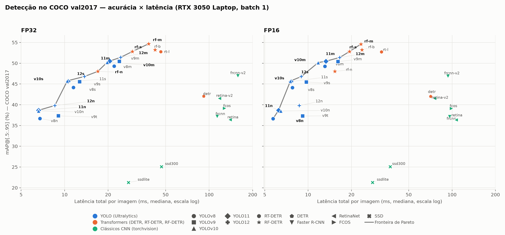

# Benchmark Reprodutível de Detectores de Objetos em Hardware de Consumidor: Acurácia e Custo Computacional de YOLO, RT-DETR, RF-DETR e Detectores Clássicos no COCO val2017

> **Rascunho v0.1.** Gerado a partir de `PROJETO.md` (v0.2) e de `results/`. Os trechos marcados com **[PENDENTE]** dependem de experimentos ainda não executados ou de verificação manual. As referências precisam ser conferidas antes da submissão.

**Autores:** [a preencher] · **Afiliação:** [a preencher] · **Contato:** [a preencher]

---

## Resumo

Os resultados publicados para detectores de objetos em tempo real raramente são comparáveis. Cada trabalho usa hardware, resolução de entrada, pós-processamento (NMS) e protocolo de medição de latência próprios. Este trabalho apresenta um benchmark sob hardware e protocolo únicos, em uma GPU de consumidor (NVIDIA RTX 3050 Laptop, 4 GB de VRAM). Avalie 28 detectores no COCO val2017 (5.000 imagens) com o avaliador oficial `pycocotools`: YOLOv8, v9, v10, 11 e 12 (portes n/t, s e m), RT-DETR-L, quatro variantes do RF-DETR, Faster R-CNN, RetinaNet, FCOS, SSD, SSDlite e DETR. Cada modelo foi medido em FP32 e FP16 (batch 1), com latência total por imagem (leitura, pré-processamento, inferência e pós-processamento), pico de memória de GPU e número de parâmetros. O RF-DETR-Medium obtém a maior acurácia (mAP@[.5:.95] = 0,547; 38,2 ms em FP32 e 23,3 ms em FP16). Os YOLO dominam a faixa abaixo de ~12 ms, e o YOLO11n alcança 0,387 de mAP em 6,6 ms. Nenhum detector clássico e nem o RT-DETR-L pertence à fronteira de Pareto acurácia × latência. O melhor detector clássico, o Faster R-CNN v2 (0,469), leva 158 ms contra 20,5 ms do YOLO11m (0,505). Em FP16, o mAP dos modelos Ultralytics varia no máximo 0,001, e o tempo dos modelos médios cai de 30 a 40 %. A única exceção é o FCOS, que perde 8 pontos de mAP com precisão mista. A segmentação, a sensibilidade à resolução e a exportação ONNX/TensorRT não foram avaliadas e são tratadas como trabalho futuro. Código, configurações e resultados brutos acompanham o artigo.

**Palavras-chave:** detecção de objetos; benchmark; YOLO; RT-DETR; RF-DETR; COCO; latência; fronteira de Pareto.

---

## 1. Introdução

Os detectores de objetos em tempo real evoluem em ciclos curtos. Desde o YOLO original [2], a família ganhou novas versões que alteram backbone, cabeça de predição e regras de treinamento [5, 6]. Em paralelo, arquiteturas baseadas em Transformers (DETR [3], RT-DETR [4], RF-DETR [10]) passaram a disputar o regime de tempo real, e algumas eliminam a etapa de supressão de não-máximos (NMS), como o YOLOv10 [5] e o RT-DETR [4].

Comparar esses modelos usando os números dos próprios artigos é problemático por quatro motivos:

1. O hardware varia: a latência reportada depende da GPU, do driver e do *runtime*.
2. A resolução de entrada e o pré-processamento diferem entre trabalhos.
3. O NMS e seus limiares são implementados de formas distintas, e há trabalhos que excluem o NMS da latência.
4. O protocolo de medição (aquecimento, sincronização da GPU, estatística reportada) raramente é descrito por completo.

Como consequência, a pergunta prática "qual detector devo usar sob um orçamento de latência e de memória?" não tem resposta direta na literatura.

Este trabalho propõe um benchmark **reprodutível, sob hardware e protocolo únicos**, que mede acurácia e custo computacional em conjunto. O cenário escolhido é deliberadamente restrito: uma GPU de notebook com 4 GB de VRAM, representativa de hardware de borda ou de consumidor. Isso limita a generalização para GPUs de data center, mas cobre uma condição de implantação frequente e pouco coberta pelos benchmarks existentes.

**Perguntas de pesquisa.** O estudo foi organizado em torno de quatro perguntas:

- **RQ1.** Qual a fronteira de Pareto acurácia × latência entre as famílias avaliadas?
- **RQ2.** Detectores *end-to-end* (sem NMS) compensam em latência real frente aos baseados em NMS?
- **RQ3.** Como o desempenho varia com o tamanho do objeto e com a resolução de entrada?
- **RQ4.** Qual o ganho de FP16 e de exportação (ONNX/TensorRT) sobre o PyTorch nativo, e a que custo de acurácia?

Nesta versão, a RQ1 é respondida; as RQ2, RQ3 e RQ4 são respondidas **parcialmente**.

**Contribuições.**

- Um protocolo único de avaliação e de medição de latência, aplicado a 28 detectores de 7 famílias, com um único avaliador COCO.
- Uma análise acurácia × latência (fronteira de Pareto) em FP32 e FP16, com a latência decomposta em etapas para os modelos Ultralytics.
- Evidências sobre o efeito de FP16 por família, incluindo uma anomalia de acurácia no FCOS.
- Código, configurações e resultados brutos (JSON por modelo e precisão) para reprodução.

**Organização.** A Seção 2 resume os trabalhos relacionados. A Seção 3 descreve a metodologia. A Seção 4 apresenta os resultados. A Seção 5 discute os achados e as ameaças à validade. A Seção 6 conclui. O Apêndice traz as configurações e os comandos de reprodução.

---

## 2. Trabalhos relacionados

**Detectores baseados em CNN.** Os detectores de dois estágios, como o Faster R-CNN [7], geram propostas de região e as classificam e refinam em seguida. Os de um estágio (RetinaNet, SSD, FCOS) predizem classes e caixas diretamente sobre mapas de características; o FCOS dispensa âncoras. A família YOLO [2] é o principal representante dos detectores de um estágio em tempo real. O YOLOv9 [6] introduz a informação de gradiente programável (PGI). O YOLOv8, o YOLO11 e o YOLO12 são distribuídos pela Ultralytics. **[PENDENTE: citar publicações ou repositórios oficiais de YOLOv8, YOLO11, YOLO12, RetinaNet, SSD e FCOS.]**

**Detectores baseados em Transformers.** O DETR [3] formulou a detecção como predição direta de um conjunto, sem NMS, mas convergia lentamente e detectava mal objetos pequenos. O RT-DETR [4] adaptou o paradigma ao tempo real com um codificador híbrido e afirma superar os YOLO em velocidade e acurácia. O RF-DETR [10] usa um backbone DINOv2 e é distribuído em variantes de tamanho crescente. O YOLOv10 [5] mantém a base convolucional, mas elimina o NMS por meio de atribuição dupla de rótulos.

**Benchmarks e protocolos.** O COCO [1] é o padrão de fato para avaliação (mAP@[.5:.95], com divisão por tamanho de objeto). Os números dos autores costumam vir de GPUs de data center, de exportações para TensorRT e, às vezes, sem contar o NMS na latência. **[PENDENTE: levantar benchmarks comparativos recentes de detectores em tempo real e posicionar este trabalho em relação a eles. Esta seção ainda não tem revisão sistemática.]**

**Lacuna.** Até onde conseguimos verificar, faltam comparações que reúnam em um único protocolo famílias CNN e Transformer, FP32 e FP16, e latência de ponta a ponta em hardware de consumidor com pouca memória.

---

## 3. Metodologia

### 3.1 Modelos avaliados

Todos os modelos usam **pesos oficiais pré-treinados em COCO train2017**, sem ajuste de hiperparâmetros por modelo, para evitar viés do avaliador.

| Família | Variantes avaliadas | Paradigma |
|---|---|---|
| YOLOv8 / YOLO11 / YOLO12 (Ultralytics) | n, s, m | CNN (YOLO12 com atenção), *anchor-free*, NMS |
| YOLOv9 | t, s, m | CNN, NMS |
| YOLOv10 | n, s, m | CNN, *NMS-free* |
| RT-DETR | L (Ultralytics) | Transformer híbrido, *end-to-end* |
| RF-DETR | Nano, Small, Medium, Base | Transformer (backbone DINOv2), *end-to-end* |
| Faster R-CNN | ResNet50-FPN v1 e v2 (torchvision) | Dois estágios |
| RetinaNet | ResNet50-FPN v1 e v2 (torchvision) | Um estágio |
| FCOS | ResNet50-FPN (torchvision) | Um estágio, *anchor-free* |
| SSD | SSD300-VGG16, SSDlite320-MobileNetV3 (torchvision) | Um estágio |
| DETR | ResNet-50 (HuggingFace) | Transformer |

Os portes l e x dos YOLO e o RT-DETR-X ficaram fora do estudo por não caberem em 4 GB de VRAM. As variantes RT-DETR-R18 e R50 (HuggingFace) não foram avaliadas. Ao todo são 28 modelos.

### 3.2 Conjunto de dados e métricas

A avaliação usa o **COCO 2017 val** (5.000 imagens, 80 classes). Como os pesos foram treinados em train2017, não há sobreposição esperada com o conjunto de avaliação. **[PENDENTE: confirmar a origem dos pesos de cada família e a ausência de vazamento.]** Predições com `category_id` fora das 80 classes COCO são descartadas.

**Acurácia.** Usamos o `pycocotools` oficial sobre as predições exportadas de cada modelo, com um único avaliador para todas as famílias. Reportamos mAP@[.5:.95] (chamado apenas de mAP), mAP@.5, mAP@.75, AP por tamanho (S/M/L) e AR@100.

**Eficiência.**

- Latência em ms por imagem, mediana e P95, medida em batch 1.
- Throughput (FPS), derivado da latência total.
- Pico de memória de GPU alocada pelo PyTorch, que não inclui o contexto CUDA.
- Número de parâmetros.

Para os modelos Ultralytics, a latência é decomposta em pré-processamento, inferência e pós-processamento (NMS).

### 3.3 Protocolo experimental

1. **Hardware único**, descrito na Seção 3.4.
2. **Limiar de confiança** `conf = 0,001` para todos os modelos (cálculo de mAP); `iou(NMS) = 0,65` nos modelos Ultralytics.
3. **Latência.** Mediana e P95 do **tempo total por imagem** (leitura do arquivo, pré-processamento, inferência e pós-processamento), com batch 1 e `torch.cuda.synchronize()` antes de cada leitura de tempo. O aquecimento descarta 50 iterações (Ultralytics e RF-DETR) ou 30 (torchvision e DETR). As 5.000 imagens são medidas, uma passada por configuração.
4. **Precisão.** FP32 e FP16. Em Ultralytics e RF-DETR, FP16 é `half` real. Em torchvision e DETR usa-se `torch.autocast` (precisão mista), porque NMS e RoIAlign em FP16 puro não são suportados de forma confiável. **A comparação de FP16 entre famílias, portanto, não é idêntica.**
5. **Registro.** Cada execução salva um JSON com métricas, versões de bibliotecas e nome da GPU.

### 3.4 Desvios em relação ao protocolo planejado

Para manter a transparência, listamos o que foi planejado e não foi feito, ou foi feito de forma diferente:

- **Resolução.** YOLO e RT-DETR rodam em 640×640. Os demais usam a **resolução nativa** de cada modelo: RF-DETR Nano 384, Small 512, Medium 576 e Base 560; Faster R-CNN, RetinaNet, FCOS e DETR com lado menor 800; SSD300 em 300; SSDlite em 320. A comparação, portanto, **não é "mesma entrada"**. O estudo de sensibilidade (320 a 1024) não foi feito.
- **Limiar de latência.** As medições com `conf = 0,25` não foram feitas. A latência reportada inclui o NMS com `conf = 0,001`, que é o caso mais pesado para os modelos Ultralytics.
- **Repetições.** Cada configuração foi medida **uma vez**. Não há barras de erro; diferenças da ordem de 0,3 ms estão dentro do ruído.
- **Decomposição da latência.** Só existe para modelos Ultralytics.
- **Não realizado:** ONNX/TensorRT, FLOPs, análise por classe, *fine-tuning*, outros conjuntos de dados e segmentação.

### 3.5 Ambiente experimental

| Item | Valor |
|---|---|
| GPU | NVIDIA GeForce RTX 3050 Laptop, 4 GB de VRAM |
| Driver | 535.230.02 (CUDA ≤ 12.2) |
| CPU / RAM | 16 threads / 7,4 GB |
| Sistema operacional | Linux 5.15 (Ubuntu) |
| Python | 3.11 (venv isolado) |
| PyTorch | 2.6.0 + CUDA 12.4 (wheels `cu124`, compatíveis com o driver 535 por compatibilidade de versão menor) |
| Bibliotecas | ultralytics 8.4.183, rfdetr 1.11.2, transformers 5.20.2, torchvision 0.21.0 (versões exatas em `requirements.lock.txt`) |

Os resultados refletem um cenário de hardware de consumidor e **não devem ser extrapolados para GPUs de data center**.

---

## 4. Resultados

Todos os resultados abaixo são de detecção no COCO val2017, executados entre 21 e 23/10/2026. A tabela completa (com P95, VRAM em FP16 e AP médio e grande) está em `results/tabela_benchmark.md`.

### 4.1 Acurácia e eficiência

**Tabela 1.** Acurácia e custo dos 28 modelos, ordenados por mAP (FP32). mAP = mAP@[.5:.95]. ms = latência total mediana por imagem, batch 1. VRAM = pico alocado pelo PyTorch, sem contexto CUDA. Em torchvision e DETR, FP16 é precisão mista.

| Modelo | Família | Entrada | Params (M) | mAP | mAP50 | AP_S | ms FP32 | ms FP16 | mAP FP16 | VRAM FP32 (MB) |
|:--|:--|--:|--:|--:|--:|--:|--:|--:|--:|--:|
| rfdetr-medium | RF-DETR | 576 | 33,7 | 0,547 | 0,735 | 0,358 | 38,2 | 23,3 | 0,546 | 322 |
| rfdetr-base | RF-DETR | 560 | 32,2 | 0,532 | 0,721 | 0,346 | 42,3 | 23,6 | 0,532 | 321 |
| rfdetr-small | RF-DETR | 512 | 32,1 | 0,528 | 0,720 | 0,317 | 29,4 | 19,4 | 0,528 | 299 |
| rtdetr-l | RT-DETR | 640 | 33,0 | 0,528 | 0,712 | 0,344 | 46,2 | 32,3 | 0,527 | 242 |
| yolo12m | YOLO12 | 640 | 20,2 | 0,514 | 0,684 | 0,345 | 24,4 | 16,6 | 0,514 | 191 |
| yolo11m | YOLO11 | 640 | 20,1 | 0,505 | 0,675 | 0,334 | 20,5 | 13,3 | 0,505 | 190 |
| yolov9m | YOLOv9 | 640 | 20,2 | 0,504 | 0,673 | 0,324 | 23,9 | 16,1 | 0,504 | 153 |
| yolov10m | YOLOv10 | 640 | 16,6 | 0,502 | 0,673 | 0,323 | 19,7 | 11,8 | 0,501 | 152 |
| yolov8m | YOLOv8 | 640 | 25,9 | 0,493 | 0,661 | 0,310 | 22,0 | 13,1 | 0,493 | 161 |
| rfdetr-nano | RF-DETR | 384 | 30,5 | 0,480 | 0,671 | 0,250 | 17,0 | 15,3 | 0,480 | 269 |
| fasterrcnn_resnet50_fpn_v2 | Faster R-CNN | 800 | 43,7 | 0,469 | 0,679 | 0,310 | 158,3 | 93,6 | 0,469 | 671 |
| yolo12s | YOLO12 | 640 | 9,3 | 0,468 | 0,636 | 0,276 | 13,7 | 9,0 | 0,468 | 110 |
| yolov10s | YOLOv10 | 640 | 8,1 | 0,458 | 0,628 | 0,262 | 10,4 | 7,5 | 0,457 | 96 |
| yolo11s | YOLO11 | 640 | 9,5 | 0,456 | 0,626 | 0,278 | 10,6 | 7,6 | 0,456 | 111 |
| yolov9s | YOLOv9 | 640 | 7,3 | 0,455 | 0,617 | 0,257 | 12,7 | 9,7 | 0,455 | 82 |
| yolov8s | YOLOv8 | 640 | 11,2 | 0,442 | 0,608 | 0,254 | 11,5 | 7,8 | 0,441 | 79 |
| detr_resnet50 | DETR | 800 | 41,5 | 0,421 | 0,623 | 0,213 | 91,7 | 71,0 | 0,420 | 477 |
| retinanet_resnet50_fpn_v2 | RetinaNet | 800 | 38,2 | 0,415 | 0,618 | 0,270 | 117,8 | 75,5 | 0,415 | 378 |
| yolo12n | YOLO12 | 640 | 2,6 | 0,398 | 0,556 | 0,194 | 8,6 | 8,7 | 0,398 | 66 |
| fcos_resnet50_fpn | FCOS | 800 | 32,3 | 0,392 | 0,583 | 0,222 | 128,0 | 102,7 | 0,310 | 423 |
| yolo11n | YOLO11 | 640 | 2,6 | 0,387 | 0,545 | 0,194 | 6,6 | 6,2 | 0,387 | 66 |
| yolov10n | YOLOv10 | 640 | 2,8 | 0,385 | 0,541 | 0,193 | 6,6 | 6,5 | 0,385 | 62 |
| yolov9t | YOLOv9 | 640 | 2,1 | 0,373 | 0,521 | 0,173 | 9,1 | 9,2 | 0,373 | 43 |
| fasterrcnn_resnet50_fpn | Faster R-CNN | 800 | 41,8 | 0,372 | 0,590 | 0,213 | 113,5 | 96,2 | 0,371 | 664 |
| yolov8n | YOLOv8 | 640 | 3,2 | 0,367 | 0,521 | 0,178 | 6,8 | 5,7 | 0,366 | 33 |
| retinanet_resnet50_fpn | RetinaNet | 800 | 34,0 | 0,364 | 0,557 | 0,191 | 139,2 | 106,4 | 0,364 | 428 |
| ssd300_vgg16 | SSD | 300 | 35,6 | 0,251 | 0,415 | 0,055 | 46,8 | 37,2 | 0,251 | 212 |
| ssdlite320_mobilenet_v3_large | SSD | 320 | 3,4 | 0,213 | 0,343 | 0,011 | 27,6 | 28,0 | 0,213 | 33 |

**Maior acurácia.** O RF-DETR-Medium lidera (mAP 0,547) e usa uma entrada menor (576 px) que a dos YOLO (640 px). O melhor YOLO é o YOLO12m (0,514; 24,4 ms). O RT-DETR-L iguala o mAP do RF-DETR-Small (0,528), mas leva 46,2 ms contra 29,4 ms.

**Faixa rápida (< ~12 ms).** É dominada por YOLO. O YOLO11n e o YOLOv10n alcançam cerca de 0,386 de mAP em cerca de 6,6 ms (FP32).

**Gerações YOLO.** O YOLOv8 e o YOLOv9 ficam abaixo de YOLO11, YOLO12 e YOLOv10 em todos os portes. O YOLOv9 é lento para o que entrega: o v9m gasta 21,2 ms só de inferência, contra 17,8 ms do YOLO11m, com mAP equivalente. O YOLO12 acrescenta cerca de 1 ponto de mAP sobre o YOLO11, mas o YOLO12n gasta 5,8 ms de inferência contra 3,8 ms do YOLO11n.

**Detectores clássicos.** O melhor, o Faster R-CNN v2 (0,469), leva 158 ms em FP32, contra 20,5 ms do YOLO11m (0,505). O SSD300 e o SSDlite são rápidos, mas atingem apenas 0,25 e 0,21 de mAP. O DETR-R50 (0,421; 92 ms) supera RetinaNet v1, FCOS e Faster R-CNN v1 em acurácia, mas é lento.

### 4.2 Fronteira de Pareto (RQ1)

A Figura 1 mostra mAP × latência total. Os modelos na fronteira (não dominados em acurácia e latência) são, em ordem crescente de latência:

- **FP32:** YOLO11n → YOLO12n → YOLOv10s → YOLO12s → RF-DETR-Nano → YOLOv10m → YOLO11m → YOLO12m → RF-DETR-Small → RF-DETR-Medium.
- **FP16:** YOLOv8n → YOLO11n → YOLOv10s → YOLO12s → YOLOv10m → YOLO11m → YOLO12m → RF-DETR-Small → RF-DETR-Medium.

**Nenhum detector clássico e nem o RT-DETR-L está na fronteira.**



*Figura 1. mAP@[.5:.95] × latência total mediana por imagem. Arquivo vetorial em `figures/pareto_benchmark.pdf`. **[PENDENTE: ajustar manualmente os rótulos do gráfico para a versão final.]***

### 4.3 Objetos pequenos (RQ3, parcial)

O AP para objetos pequenos (AP_S) separa os modelos mais do que o mAP geral:

| Modelo | AP_S |
|:--|--:|
| RF-DETR-Medium | 0,358 |
| YOLO12m | 0,345 |
| RT-DETR-L | 0,344 |
| YOLO11m | 0,334 |
| Faster R-CNN v2 | 0,310 |
| SSD300 | 0,055 |
| SSDlite320 | 0,011 |

O SSD e o SSDlite quase não detectam objetos pequenos, o que é coerente com suas entradas de 300–320 px. A degradação em função da resolução de entrada **não foi estudada**.

### 4.4 Efeito de FP16 (RQ4, parcial)

- **Ultralytics.** FP16 não altera o mAP (variação ≤ 0,001). Reduz em cerca de 30 a 40 % o tempo dos modelos médios e quase metade da VRAM. Nos modelos nano, o ganho é pequeno, e o YOLO12n e o YOLOv9t ficam ligeiramente mais lentos em FP16 (8,6 → 8,7 ms; 9,1 → 9,2 ms), diferença dentro do ruído.
- **RF-DETR.** O mAP é preservado. O RF-DETR-Base cai de 42,3 para 23,6 ms; o Nano, de 17,0 para 15,3 ms.
- **torchvision e DETR (precisão mista).** O mAP é preservado, com uma exceção, descrita a seguir.
- **Anomalia do FCOS.** O mAP cai de 0,392 (FP32) para 0,310 (FP16 com `autocast`), enquanto os demais modelos praticamente não mudam. Uma execução de diagnóstico (`results/diag/`) reproduziu o valor de 0,310 e mostrou perda concentrada em mAP50 (0,583 → 0,451) e em AP_S (0,222 → 0,197). A causa provável é instabilidade numérica do `autocast` na cabeça do FCOS ou na decodificação das caixas, mas **isso não foi verificado**. O valor FP16 do FCOS não deve ser usado sem investigação. **[PENDENTE: concluir o diagnóstico (`scripts/diag_fcos_fp16.py`, `scripts/diag_fcos_decode.py`).]**

A exportação para ONNX/TensorRT **não foi avaliada**, de modo que a RQ4 só é respondida para o ganho de FP16.

### 4.5 Segmentação (RQ5)

**Não executada.** Os adaptadores para segmentação de instância (`src/benchmark/eval_seg.py`, `scripts/run_seg.sh`) foram escritos, mas nunca testados. A segmentação semântica exige outro conjunto de dados e não foi iniciada. **[PENDENTE: executar ou retirar do escopo do artigo.]**

---

## 5. Discussão e ameaças à validade

### 5.1 Discussão

**Compromisso acurácia × latência (RQ1).** Em hardware de 4 GB, a fronteira de Pareto é formada quase só por YOLO e RF-DETR. Para orçamentos abaixo de ~12 ms, a escolha está entre YOLO11n/YOLOv10n e os portes s. A partir de ~20 ms, o YOLO11m e o YOLOv10m fornecem 0,50 de mAP, e o RF-DETR-Small/Medium oferece 0,53–0,55 por 29–38 ms. O RF-DETR-Medium obtém o maior mAP com entrada de 576 px, mas usa mais memória que os YOLO médios (322 MB contra cerca de 190 MB). Os detectores clássicos de 2015–2020 não têm lugar na fronteira: gastam de 5 a 20 vezes mais tempo por imagem para acurácia igual ou menor.

**End-to-end × NMS (RQ2, parcial).** O YOLOv10 (sem NMS) está na fronteira nos portes s e m, e o RF-DETR (sem NMS) ocupa o topo. Já o RT-DETR-L, também *end-to-end*, é dominado. Portanto, ser livre de NMS não garante vantagem de latência: o resultado depende da arquitetura como um todo. Como a decomposição da latência só existe para os modelos Ultralytics, **não é possível atribuir a diferença ao pós-processamento**. Além disso, o RF-DETR usa 300 consultas fixas e roda em resolução diferente da dos YOLO.

**Ganho de FP16 (RQ4).** O ganho é grande nos modelos médios, onde a computação domina, e pequeno nos nano, onde a latência é limitada por leitura de arquivo, pré-processamento e lançamento de kernels. Em um modelo de 6 ms, esses custos fixos pesam mais que a inferência.

**Plausibilidade dos números.** O YOLO11n obteve 0,387 de mAP, contra 39,5 divulgado pela Ultralytics para o mesmo modelo, o que indica que a conversão e a avaliação estão corretas. Os valores dos demais modelos **ainda não foram comparados sistematicamente** com os divulgados pelos autores. **[PENDENTE.]**

### 5.2 Ameaças à validade

**Validade interna.**

- **Medição única.** Cada latência foi medida uma vez, sem barras de erro. Diferenças pequenas (da ordem de 0,3 ms) não devem ser interpretadas. Uma consequência é que a posição de modelos próximos na fronteira (por exemplo, YOLO11n e YOLOv10n) é incerta.
- **Efeitos térmicos.** A GPU atingiu cerca de 75 °C nas execuções longas. O clock não foi registrado, e *throttling* não pode ser descartado. A ordem de execução dos modelos pode ter influenciado a latência.
- **Latência total.** Ela inclui leitura de arquivo em disco, o que favorece a comparação de ponta a ponta, mas mistura custos da CPU e do disco com os da GPU. Nos Ultralytics inclui o NMS com `conf = 0,001`, que é mais custoso que com `conf = 0,25`.
- **Pós-processamento não equivalente.** Cada biblioteca implementa o NMS e o *top-k* à sua maneira.

**Validade de construto.**

- **Entradas diferentes.** Modelos em resoluções diferentes (300 a 800 px) não são comparáveis "à mesma entrada". Parte da vantagem do YOLO sobre os modelos de 800 px pode ser efeito da resolução, e não da arquitetura. O RF-DETR obtém o melhor mAP mesmo com entrada menor, o que reforça a conclusão a seu favor, mas não isola o efeito.
- **FP16 não idêntico.** `half` real e `autocast` são mecanismos diferentes; comparar ganhos de FP16 entre famílias deve ser feito com cautela.
- **Pesos oficiais.** Como cada modelo usa receitas de treinamento próprias (épocas, aumento de dados, pré-treinamento), as diferenças medem **pacote de arquitetura + receita**, e não apenas a arquitetura.

**Validade externa.**

- **Hardware único.** Uma GPU de notebook com 4 GB. A fronteira de Pareto pode mudar em GPUs maiores, em outros *runtimes* (TensorRT) ou em CPU. Modelos grandes (portes l/x) não foram avaliados por falta de memória.
- **Um conjunto de dados.** Somente COCO val2017. A generalização para outros domínios não foi testada.
- **Escopo incompleto.** Segmentação, sensibilidade à resolução e exportação não foram avaliadas; as conclusões se restringem à detecção em PyTorch.

**Conflitos de licença e uso.** Os modelos Ultralytics (YOLOv8/11/12) são licenciados sob AGPL-3.0; RF-DETR e RT-DETR têm licenças distintas. **[PENDENTE: verificar licenças e incluir nota para uso comercial.]**

### 5.3 Trabalho futuro

1. Repetir cada medição de latência (3 a 5 rodadas), registrando temperatura e clock da GPU.
2. Estudar a sensibilidade à resolução (320 a 1024) e igualar as entradas entre famílias.
3. Investigar a queda de acurácia do FCOS em FP16.
4. Avaliar ONNX/TensorRT e latência com `conf = 0,25`.
5. Incluir segmentação de instância (YOLO-seg, Mask R-CNN) e semântica (SegFormer, DeepLabV3+).
6. Incluir RT-DETR-R18/R50 e os portes l/x onde couberem.
7. Medir a decomposição da latência (pré, inferência, pós) em todas as famílias para isolar o custo do NMS.
8. Avaliar um conjunto de dados de domínio específico, com *fine-tuning* curto.

---

## 6. Conclusão

Este trabalho comparou 28 detectores de objetos de 7 famílias, em um protocolo único e em uma GPU de consumidor com 4 GB de VRAM. As principais conclusões, restritas a este hardware e ao COCO val2017, são:

1. A fronteira de Pareto acurácia × latência é formada por modelos YOLO e RF-DETR; os detectores clássicos e o RT-DETR-L são dominados.
2. O RF-DETR-Medium atinge o maior mAP (0,547), e o YOLO11/YOLOv10 oferecem o melhor custo-benefício na faixa de 6 a 20 ms.
3. FP16 preserva a acurácia e reduz de 30 a 40 % a latência dos modelos médios, com a exceção do FCOS com precisão mista.
4. Ser livre de NMS não implica menor latência por si só.

As limitações são relevantes: medição única de latência, resoluções distintas entre famílias, ausência de segmentação, de ONNX/TensorRT e de estudo de resolução. Disponibilizamos código, configurações e resultados brutos para que terceiros reproduzam e estendam o estudo.

---

## Agradecimentos

[a preencher]

## Disponibilidade de código e dados

Código, configurações e resultados brutos (um JSON por modelo e precisão, mais `tabela_benchmark.{md,csv}` e logs) estão no repositório do projeto. **[PENDENTE: inserir URL pública.]**

## Referências

> **[PENDENTE: conferir título, autores, ano e local de publicação de cada item antes da submissão, e completar as referências ausentes (YOLOv8/11/12, RetinaNet, SSD, FCOS, Mask R-CNN, SegFormer e SAM, se usados).]**

1. T.-Y. Lin et al. *Microsoft COCO: Common Objects in Context.* ECCV, 2014.
2. J. Redmon et al. *You Only Look Once: Unified, Real-Time Object Detection.* CVPR, 2016.
3. N. Carion et al. *End-to-End Object Detection with Transformers (DETR).* ECCV, 2020.
4. Y. Zhao et al. *DETRs Beat YOLOs on Real-time Object Detection (RT-DETR).* CVPR, 2024.
5. A. Wang et al. *YOLOv10: Real-Time End-to-End Object Detection.* NeurIPS, 2024.
6. C.-Y. Wang et al. *YOLOv9: Learning What You Want to Learn Using Programmable Gradient Information.* 2024.
7. S. Ren et al. *Faster R-CNN: Towards Real-Time Object Detection with Region Proposal Networks.* NeurIPS, 2015.
8. K. He et al. *Mask R-CNN.* ICCV, 2017. *(só será citada se a segmentação for incluída)*
9. E. Xie et al. *SegFormer: Simple and Efficient Design for Semantic Segmentation with Transformers.* NeurIPS, 2021. *(idem)*
10. Roboflow (I. Robicheaux et al.). *RF-DETR.* 2025.
11. A. Kirillov et al. *Segment Anything.* ICCV, 2023. *(idem)*

---

## Apêndice A. Configurações e comandos para reprodução

### A.1 Ambiente

```bash
./setup_env.sh                # cria .venv com as versões de requirements.lock.txt
scripts/download_coco.sh      # baixa COCO val2017 em data/coco/
```

Versões exatas: ver Seção 3.5 e `requirements.lock.txt`.

### A.2 Execução dos modelos

```bash
scripts/run_yolo_all.sh       # YOLOv8/9/10/11/12 (n/t, s, m), FP32 e FP16
scripts/run_rtdetr.sh         # RT-DETR-L
scripts/run_rfdetr.sh         # RF-DETR Nano/Small/Medium/Base
scripts/run_classic.sh        # Faster R-CNN, RetinaNet, FCOS, SSD, SSDlite, DETR
```

Equivalente a, para um modelo Ultralytics individual:

```bash
.venv/bin/python -m src.benchmark.eval_ultralytics --weights yolo11n.pt          # FP32
.venv/bin/python -m src.benchmark.eval_ultralytics --weights yolo11n.pt --half   # FP16
```

Cada execução grava `results/<modelo>_<entrada>[_fp16].json` e um log em `results/logs/`.

### A.3 Tabelas e figuras

```bash
.venv/bin/python -m src.benchmark.make_table    # results/tabela_benchmark.{md,csv}
.venv/bin/python -m src.benchmark.plot_pareto   # paper/figures/pareto_benchmark.{png,pdf}
```

### A.4 Diagnóstico do FCOS em FP16

```bash
.venv/bin/python scripts/diag_fcos_fp16.py 500     # compara variantes em N imagens
.venv/bin/python scripts/diag_fcos_decode.py       # erro da decodificação de caixas em FP16 vs FP32
```

### A.5 Parâmetros de avaliação

| Parâmetro | Valor |
|---|---|
| Conjunto | COCO val2017, 5.000 imagens |
| Batch | 1 |
| `conf` | 0,001 |
| `iou` (NMS, Ultralytics) | 0,65 |
| Aquecimento | 50 iterações (Ultralytics, RF-DETR); 30 (torchvision, DETR) |
| Imagens medidas | 5.000 (uma passada) |
| Estatística de latência | Mediana e P95 do tempo total por imagem |
| Sincronização | `torch.cuda.synchronize()` antes de cada leitura |
| Avaliador | `pycocotools` oficial |

> **Nota de verificação.** Os comandos do apêndice foram reconstruídos a partir da estrutura do repositório descrita em `PROJETO.md` e dos scripts em `scripts/`. **[PENDENTE: conferir os nomes de módulos e de argumentos de `make_table` e `plot_pareto` e dos scripts RF-DETR e clássicos antes da publicação.]**
